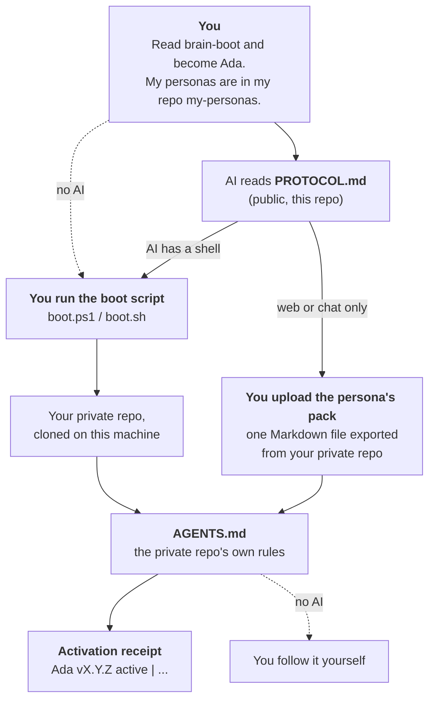
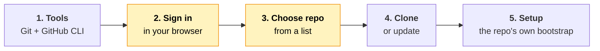

# brain-boot

**Cold start for portable AI personas.** One sentence turns any AI, on any machine, into one of your own agents, with that agent's identity, character, role and knowledge loaded from **your private repository**. This public repo holds only the method and the bootstrap. It contains none of your data, and none of anyone else's.

> **AI agents: start with [PROTOCOL.md](PROTOCOL.md).**
> **People: jump to [Quick start](#quick-start).** It works with an AI or without one.

---

## Why

People who work with several AIs (on several PCs, accounts and apps) rebuild the same context again and again: who the agent is, how it should behave, what it already knows. *brain* keeps that in a private git repository as **personas**: versioned, reviewable, restorable and able to learn. The hard part is the **first contact**: a fresh AI doesn't know your repo exists, and can't read it because it's private.

brain-boot solves only that first contact, and does it in the open so any AI can read it without signing in.

## Goals

1. **Any AI, from zero.** One sentence is enough: *"Read github.com/princekiese/brain-boot and become Ada. My personas are in my GitHub repo my-personas."*
2. **No AI needed either.** Every step can be done by hand, by a person, with the same script or with four plain commands.
3. **Nothing private in public.** The private repo's name is given in the conversation or at the script's prompt, never written here. No people, personas, machines, paths or credentials are published. A policy check enforces it before every release.
4. **Credentials never pass through an AI.** Sign-in happens in your browser, through GitHub's own flow.
5. **Readable and verifiable.** Short scripts with comments, official package sources only, and SHA-256 checksums for every file.

## How it works



*Ada* and *my-personas* are only examples: use your own persona and repo names. Dotted lines are the route without an AI.

Access to the private repo is controlled by GitHub: only accounts you've granted access can clone it. Knowing this page doesn't give anyone anything.

## Quick start

Every command below works **exactly as written**: copy, paste, press Enter. You don't edit anything; the script asks for your repo *after* you've signed in, and shows you a list to pick from.

The commands download the script from the **latest release** (a fixed, tagged version), check it, let you read it, then run it.

### Windows (PowerShell)

```powershell
cd $HOME
Invoke-WebRequest https://github.com/princekiese/brain-boot/releases/latest/download/boot.ps1 -OutFile boot.ps1
Invoke-WebRequest https://github.com/princekiese/brain-boot/releases/latest/download/SHA256SUMS -OutFile SHA256SUMS
(Get-FileHash boot.ps1).Hash -eq (Select-String ' boot\.ps1$' SHA256SUMS).Line.Split(' ')[0]
notepad boot.ps1
powershell -ExecutionPolicy Bypass -File .\boot.ps1
```

Line 4 must print **True**. If it prints **False**, stop: the file isn't the published one.

### macOS / Linux

```sh
cd ~
curl -fsSLO https://github.com/princekiese/brain-boot/releases/latest/download/boot.sh
curl -fsSLO https://github.com/princekiese/brain-boot/releases/latest/download/SHA256SUMS
grep ' boot.sh$' SHA256SUMS | shasum -a 256 -c
less boot.sh
sh boot.sh
```

Line 4 must print **boot.sh: OK**. If it prints anything else, stop: the file isn't the published one. (Linux without `shasum`: use `sha256sum -c` instead.)

### What the script does, and what you'll see



Highlighted steps need you. Everything else runs on its own.

| Step | What happens | What you do |
|---|---|---|
| 1. Tools | Installs Git and GitHub CLI if missing (winget / Homebrew; on Linux it prints the `apt` command for you) | Allow the install if Windows asks |
| 2. Sign-in | GitHub CLI shows a one-time code and opens your browser | Answer **Y** if asked *"Authenticate Git…?"*, press **Enter**, then sign in and paste the code **in the browser** |
| 3. Choose repo | Lists your private repos | Type the **number**, or a name like `my-personas`, or `owner/my-personas` |
| 4. Clone | Clones it into your user folder (or updates it) | Nothing |
| 5. Setup | Runs the repo's own `bootstrap.ps1` / `bootstrap.sh`, if it has one | Whatever that setup asks |

When it finishes it prints where your repo is and what to do next. It's safe to rerun: finished steps are skipped. If it stops, it says why in one line.

Optional arguments skip the question in step 3: `-Repo my-personas` (Windows) or `sh boot.sh my-personas` (macOS / Linux). `-Dest` / a second argument picks another folder.

### Then: with an AI

Tell it:

> My persona repo is at ~/my-personas. Read its AGENTS.md and become Ada.

(Use the folder the script printed and your persona's name.)

### Then: without an AI

Open `AGENTS.md` in the cloned folder and follow it yourself: it's your repo's own description of how a persona is activated. If your repo can export a persona as a single-file pack, that file is also what you'd upload to a chat-only AI later.

## Manual route (no script, no AI)

If you'd rather not run the script, these are the same steps by hand. Replace `my-personas` with your repo's name.

| Step | Windows | macOS | Linux (Debian/Ubuntu) |
|---|---|---|---|
| 1. Tools | `winget install --id Git.Git -e` and `winget install --id GitHub.cli -e`, then open a new window | `brew install git gh` | `sudo apt-get install -y git gh` ([gh install notes](https://github.com/cli/cli/blob/trunk/docs/install_linux.md)) |
| 2. Sign in | `gh auth login --web` | same | same |
| 3. Find your repo | `gh repo list --visibility private` | same | same |
| 4. Clone | `gh repo clone my-personas` | same | same |
| 5. Setup | `cd my-personas` then `powershell -ExecutionPolicy Bypass -File .\bootstrap.ps1` (if the file exists) | `cd my-personas` then `sh bootstrap.sh` (if it exists) | same as macOS |

Then open `AGENTS.md` in that folder, as above.

## Repository structure

| File | For | What it is |
|---|---|---|
| `README.md` | People | This page: purpose, quick start, manual route, security, contributing |
| `PROTOCOL.md` | AI agents | The step-by-step cold-start protocol an AI follows |
| `SECURITY.md` | Everyone | What's public, what isn't, threat model, how to verify the scripts |
| `boot.ps1` | Windows | Bare machine → Git + GitHub CLI → browser sign-in → pick repo → clone → that repo's `bootstrap.ps1` |
| `boot.sh` | macOS / Linux | Same, for POSIX shells |
| `SHA256SUMS` | Everyone | Checksums of every file in this release |
| `LICENSE` | Everyone | MIT |

## Requirements for your private repo

brain-boot works with any private repo that has an `AGENTS.md` at its root describing how an AI (or a person) activates a persona. A `bootstrap.ps1` / `bootstrap.sh` is optional: if present, the boot script runs it after cloning.

## Security and privacy

Summary below. Details and the threat model are in [SECURITY.md](SECURITY.md).

- **Public here**: the protocol, these scripts, this README. That's all.
- **Never here**: personas, people, machines, repo names, paths, emails, tokens. Checked automatically before every release.
- **The scripts**: install only Git and GitHub CLI from winget / Homebrew / apt, never ask for credentials, and change nothing outside your user's normal install locations. Linux `sudo` steps are printed for you to run, not run for you. The repo list in step 3 is read from GitHub with your own sign-in and shown only in your terminal.
- **AIs following the protocol** are told never to ask for or accept passwords, tokens or codes, and never to copy private content into public places.

## Changelog

- **v1.1.1**: Diagrams instead of text drawings. Quick start downloads from the latest release and checks the checksum for you (True / OK). Each release now carries `boot.ps1`, `boot.sh` and `SHA256SUMS` as downloads.
- **v1.1.0**: Sign in first, then pick your repo from a list (or type just its name). No placeholders in any command. Plain one-line errors, safe reruns, clear "what next" at the end. Manual route without script or AI. Protocol: no Git needed to start; the AI hands the person ready-to-run commands.
- **v1.0.0**: First release.

## Maintainer

Maintained by **Prince Kiese** ([@princekiese](https://github.com/princekiese)), who also designed the persona framework it boots. This is a personal project, used daily across several machines and AI apps.

## Contributing

Suggestions are welcome:
- **Issues** for bugs, unclear steps, or an AI that didn't follow the protocol (say which AI and app).
- **Pull requests** for fixes to the scripts or the protocol. Keep the scripts short, dependency-free and readable, and keep this repo generic.
- **Never include personal data** in issues or PRs: no repo names, persona contents, paths, logs with usernames, or tokens. Anything like that gets removed.

## License

MIT, see [LICENSE](LICENSE).
